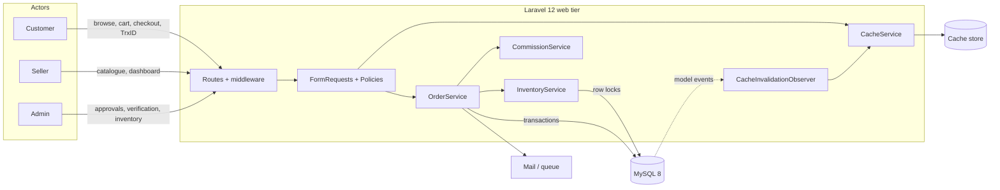
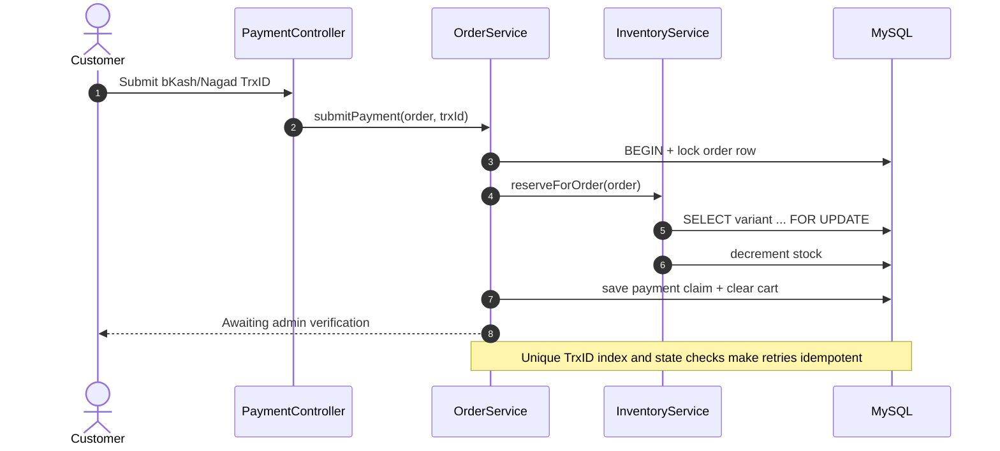

<div align="center">
  

  <h1>Sordar Agro</h1>

  <p><strong>A verified multi-seller aquarium marketplace for Bangladesh.</strong></p>

  <p>
    Fish pairs, aquatic plants, food, and equipment — backed by transactional
    inventory, admin-verified payments, and profit-share analytics.
  </p>

  <p>
    <a href="https://github.com/NafisAfzal/Sordar-Agro/actions/workflows/ci.yml">
      
    </a>
    
    
    
    
    
    <a href="SECURITY.md">
      
    </a>
    
    <a href="#testing">
      
    </a>
  </p>

  <p>
    <a href="#quick-start">Quick start</a> ·
    <a href="#architecture">Architecture</a> ·
    <a href="#testing">Testing</a> ·
    <a href="#security">Security</a> ·
    <a href="#project-structure">Project structure</a>
  </p>
</div>

---

## Overview

**Sordar Agro** is a full-stack Laravel marketplace for aquarium hobbyists. Customers
browse fish, plants, food, and equipment; sellers manage their own catalogue and
analytics; administrators approve products, verify manual mobile-money payments,
manage inventory, and monitor marketplace performance.

The project is built around a few deliberately unglamorous engineering decisions:

- **Stock is reserved when a customer submits a Transaction ID**, not when the
  checkout page is loaded.
- **Every reservation, release, and manual stock adjustment takes a database row
  lock** inside a transaction, so two concurrent buyers cannot oversell the same
  variant.
- **A submitted bKash/Nagad TrxID is a claim, not proof.** An admin verifies the
  transfer before the order becomes paid.
- **Profit share is snapshotted on the order line**, so historical seller earnings do
  not change when a product is edited later.
- **Dashboard and sitemap caches are invalidated by model observers**, not by
  scattered controller calls.

> The result is a marketplace that behaves like an operations-heavy commerce system:
> explicit state transitions, auditable money flows, row-level concurrency control,
> server-side authorization, and a test suite that protects the sharp edges.

### Three workspaces, one marketplace

| Workspace | What it does |
|-----------|--------------|
| **Customer** | Register, browse and filter the catalogue, manage a cart and wishlist, place orders, submit a bKash/Nagad TrxID, track fulfilment, and contribute community posts. |
| **Seller** | Admin-provisioned partner account with a product workspace (subject to approval), a date-filtered analytics dashboard, low-stock alerts, gross sales, marketplace share, and seller earnings. |
| **Admin** | Marketplace-wide analytics, product approval, inventory adjustment, order fulfilment, payment verification, seller and user management, care guides, and community moderation. |

### Marketplace rules that matter

- **Fish are sold in pairs.** One unit of fish stock represents two fish. Fish
  products have small, medium, and large variants; each variant has its own price,
  stock, and description.
- **Non-fish products** use a single `standard` variant.
- **Manual payments.** The customer sends money through bKash or Nagad, then submits
  the resulting TrxID. The order stays `unpaid / awaiting verification` until an admin
  verifies it.
- **Reservation TTL.** Unverified reservations expire after 24 hours by default
  (`RESERVATION_TTL_HOURS` / `config/orders.php`) and are released by the hourly
  `orders:release-stale-reservations` command.
- **Couriers are simulated** for the academic scope: an order can be assigned a
  courier and a generated tracking code without a live Pathao/Steadfast integration.
- **Restock notifications** are sent to wishlisted customers when a product moves
  from out of stock back into stock. With `MAIL_MAILER=log`, they are written to
  `storage/logs/laravel.log`.

---

## Engineering highlights

### 1. Atomic checkout with row-level locks

`OrderService::placeOrder()` creates the order and line-item snapshots in one
`DB::transaction()`. Cart rows and variant rows are read with `lockForUpdate()`
before stock is checked, closing the cart-to-order time-of-check/time-of-use window.

Stock is **not** decremented at checkout. The reservation happens in
`OrderService::submitPayment()` when the customer submits a TrxID, and the same
transaction also clears the cart and records the payment claim.

```php
return DB::transaction(function () use ($user, $data) {
    $items = Cart::with('variant.product')
        ->where('user_id', $user->id)
        ->lockForUpdate()
        ->get();

    // ... create the order, then lock and validate each variant ...
});
```

### 2. A payment state machine that cannot double-reserve

Every transition locks the order aggregate first and re-checks its state:

- `submitPayment()` — reserve stock, save the TrxID, clear the cart.
- `verifyPayment()` — mark paid; never decrement stock again.
- `rejectPayment()` — release stock exactly once and notify wishlists.
- `expireReservation()` — release a stale reservation and cancel the order.
- `updateFulfillment()` — cancel a paid/pending order and release stock once.

Duplicate tabs, retried requests, and repeated admin clicks are absorbed by state
checks and database uniqueness constraints.

### 3. Domain services instead of controller logic

| Service | Responsibility |
|---------|----------------|
| `App\Services\OrderService` | Order lifecycle, reservations, verification, rejection, expiry, fulfilment. |
| `App\Services\InventoryService` | Locked stock reservation, release, manual adjustment, restock notifications. |
| `App\Services\CommissionService` | Marketplace share and seller-earnings arithmetic. |
| `App\Services\CacheService` | Versioned dashboard keys and sitemap invalidation. |

Controllers orchestrate; services own the domain rules.

### 4. Policy-based authorization

`ProductPolicy` and `OrderPolicy` enforce object-level access. Admins receive every
ability through `before()`; sellers can only manage their own unapproved products;
customers can only read their own orders.

```php
public function before(User $user, string $ability): ?bool
{
    return $user->isAdmin() ? true : null;
}
```

### 5. FormRequests at the boundary

Twenty FormRequest classes validate and normalize input before it reaches a
controller or service. The payment request is a good example: it uppercases and trims
the TrxID, rejects malformed values, and enforces a database-backed uniqueness rule.

### 6. Cache invalidation through observers

Dashboard caches use a versioned-key strategy rather than cache tags, because the
production database/file cache stores do not support tags. A single version bump
invalidates every dashboard variant.

`CacheInvalidationObserver` is registered against products, variants, orders, order
items, care guides, community submissions, and users. Model saves and deletes bump
the dashboard version; product and care-guide changes also clear the sitemap cache.

### 7. Security and operations are first-class

- CSP, HSTS (HTTPS + production), COOP/CORP, frame, MIME, and referrer protections.
- Named rate limiters for login, registration, password resets, search suggestions,
  community submissions, and payment submissions.
- Encrypted sessions, a 30-minute idle timeout for admin/seller roles, and a
  12-hour absolute session cap for all roles.
- Unique, normalized TrxIDs with a database unique index.
- Hourly reservation-expiry and queue-health commands.
- `composer audit`, `composer validate --strict`, and a CI matrix covering PHP 8.3,
  PHP 8.4, MySQL 8.4, Node dependency auditing, and a Docker image build.

### Release verification

| Gate | Result |
|------|--------|
| `php artisan test` | **367 passed** (999 assertions) |
| `composer audit` | **No security advisories** |
| `composer validate --strict` | **Valid** |
| CI workflow | PHP 8.3/8.4 + MySQL 8.4, npm audit, Docker build |

Verified locally on **2026-11-06**.

---

## Architecture

### System map



The web tier is deliberately thin: routes select middleware, FormRequests validate
the boundary, policies authorize the actor, and domain services perform the state
change inside a transaction.

### Reservation flow



An admin later calls `verifyPayment()` or `rejectPayment()`. Verification changes the
payment status only; rejection releases the reserved stock. If nobody acts within the
TTL, the scheduled `orders:release-stale-reservations` command runs the same release
path through `OrderService::expireReservation()`.

### Data model at a glance

| Area | Tables |
|------|--------|
| Identity | `users` |
| Catalogue | `categories`, `products`, `product_variants`, `product_images` |
| Commerce | `carts`, `wishlists`, `orders`, `order_items` |
| Content | `care_guides`, `community_submissions` |
| Infrastructure | `cache`, `jobs` (Laravel defaults) |

The schema contains **17 migrations**, **11 Eloquent models**, and **20 FormRequest
classes**. Order lines snapshot product name, variant label, unit price, quantity, and
marketplace share so historical reporting remains stable.

---

## Tech stack

| Layer | Choice |
|-------|--------|
| Runtime | PHP **8.2+** locally; PHP **8.4** in the production container |
| Framework | **Laravel 12** |
| Database | **MySQL 8.x** by default; SQLite in-memory for the PHPUnit suite |
| Frontend | **Blade + Bootstrap 5.3 + custom CSS design tokens** (`public/css/app.css`) |
| Authentication | Hand-rolled session auth with `customer` / `seller` / `admin` roles |
| PHP tests | **PHPUnit 11** — 43 feature test files + 5 unit test files |
| Browser tests | **Playwright 1.49+ + axe-core** — desktop, mobile, and tablet projects |
| CI | GitHub Actions: PHP 8.3/8.4 + MySQL 8.4, npm audit, Docker build |
| Container | PHP 8.4 CLI + Supervisor (web process + queue worker) |

There is no Vite or npm build step for the application itself; Bootstrap is loaded
from a CDN. npm is used only for the Playwright E2E suite.

---

## Quick start

### Prerequisites

- **PHP 8.2+** with `pdo`, `pdo_mysql`, `mbstring`, `openssl`, `tokenizer`, `xml`,
  `ctype`, `json`, `bcmath`, `fileinfo`, and `zip`.
- **Composer 2**
- **MySQL 8.x** (or SQLite for a quick local run)
- **Node 20+** only if you want to run Playwright

### 1. Clone and install

```bash
git clone https://github.com/NafisAfzal/Sordar-Agro.git
cd Sordar-Agro
composer install
```

### 2. Create the environment file

```bash
cp .env.example .env
```

On Windows PowerShell:

```powershell
Copy-Item .env.example .env
```

### 3. Generate the application key

```bash
php artisan key:generate
```

### 4. Configure MySQL

Create the database:

```sql
CREATE DATABASE sordar_agro
    CHARACTER SET utf8mb4
    COLLATE utf8mb4_unicode_ci;
```

The default `.env.example` values already point at a local MySQL database. Adjust
them if your credentials differ:

```dotenv
DB_CONNECTION=mysql
DB_HOST=127.0.0.1
DB_PORT=3306
DB_DATABASE=sordar_agro
DB_USERNAME=root
DB_PASSWORD=
```

### 5. Migrate and seed

```bash
php artisan migrate --seed
php artisan storage:link
```

The seeder creates demo accounts, categories, fish and non-fish products, a pending
seller product for the approval queue, and care guides.

### 6. Serve

```bash
php artisan serve
```

Open <http://127.0.0.1:8000>.

For queued work, run a worker in a second terminal:

```bash
php artisan queue:work
```

### SQLite alternative

For a throwaway local database, set `DB_CONNECTION=sqlite`, remove the other `DB_*`
lines, create the file, and migrate:

```bash
touch database/database.sqlite
php artisan migrate --seed
```

On Windows PowerShell, create the file with `New-Item database/database.sqlite`.

### Demo accounts

| Role | Email | Password |
|------|-------|----------|
| Administrator | `admin@example.com` | `password` |
| Partner Seller | `seller@example.com` | `password` |
| Customer | `customer@example.com` | `password` |

> Change these credentials before any real deployment. The production seeder refuses
> to create demo accounts unless `ALLOW_DEMO_SEED=true` is explicitly set.

### Playwright E2E setup

The Playwright config expects a seeded application running at
`http://localhost:8000`.

```bash
npm ci
npx playwright install

# Terminal 1
php artisan serve

# Terminal 2
npm run test:e2e
```

Clean up E2E orders and restore reserved stock:

```bash
php artisan e2e:cleanup
php artisan e2e:verify-clean
```

Both commands are gated to `local` and `testing` environments and refuse to run in
production.

---

## Testing

### Verification snapshot

| Check | Command | Result |
|-------|---------|--------|
| Full PHP suite | `php artisan test` | **367 passed** (999 assertions) |
| Composer audit | `composer audit` | **No advisories** |
| Composer manifest | `composer validate --strict` | **Valid** |
| Browser suite | `npm run test:e2e` | Requires a running seeded app |

The PHP style check (`vendor/bin/pint --test`) and npm audit are part of the
development/CI workflow and are listed under [Useful commands](#useful-commands).

### Test matrix

| Layer | Scope |
|-------|-------|
| **Unit** (`tests/Unit`) | Model arithmetic, order-line totals, status colors, product stock helpers, cart subtotals. |
| **Feature** (`tests/Feature`) | Auth and role redirects, authorization, checkout, payment verification, reservation expiry, inventory, seller/admin dashboards, profit share, cache invalidation, rate limiting, security headers, CSP, sitemap, wishlists, validation, and failure paths. |
| **E2E** (`e2e`) | 9 Playwright specs covering accessibility (axe WCAG 2.0/2.1 A+AA), authentication, cart and checkout, catalogue filters, mobile navigation, product detail, SEO metadata, and visual regression — across desktop, mobile, and tablet profiles. |
| **CI** | `.github/workflows/ci.yml` runs the PHP suite on PHP 8.3 and 8.4 against MySQL 8.4, audits Composer and npm dependencies, and builds the Docker image. |

The PHP suite uses an in-memory SQLite database (`phpunit.xml`) and runs in roughly
23 seconds locally.

### Useful commands

```bash
php artisan test --compact
php artisan test --testsuite=Unit
php artisan test --testsuite=Feature
composer audit
composer validate --strict
vendor/bin/pint --test
npm ci && npm run test:e2e
```

---

## Security

Sordar Agro treats payment claims, inventory, and role boundaries as security
surfaces rather than UI details.

| Layer | Control |
|-------|---------|
| **Authentication** | Session auth, active-account checks, role middleware, forced password change for provisioned sellers. |
| **Authorization** | Policies for products and orders; ownership checks for customer orders; admin-only state transitions. |
| **Payments** | TrxID normalization, validation, database uniqueness, admin verification, release-on-rejection. |
| **Inventory** | `lockForUpdate()` inside transactions for reservation, release, and manual adjustment. |
| **HTTP** | CSP, HSTS in production over HTTPS, COOP/CORP, `X-Frame-Options`, `X-Content-Type-Options`, Referrer-Policy, Permissions-Policy. |
| **Sessions** | Encrypted sessions, secure cookies in production, 30-minute idle timeout for admin/seller roles, 12-hour absolute cap for all roles, and session invalidation on password change. |
| **Abuse prevention** | Named rate limiters for login, registration, password reset, suggestions, community, and payment submissions. |
| **Dependencies** | `composer audit` in CI; Composer configured with `audit.block-insecure=true`; weekly Dependabot checks. |
| **Demo data** | Production seeding guard: demo users are skipped unless `ALLOW_DEMO_SEED=true`. |

Read the full remediation report in
[`docs/security/2026-10-23-audit-remediation.md`](docs/security/2026-10-23-audit-remediation.md)
and the private disclosure process in [`SECURITY.md`](SECURITY.md).

> **Payment verification is manual by design.** The system does not call a live
> bKash/Nagad API. An admin must match the TrxID, amount, and sender against the
> mobile-money statement before pressing **Verify payment**.

---

## Production deployment

The repository ships a single-container `Dockerfile` based on **PHP 8.4**. Supervisor
runs the web process and a queue worker. A `/up` healthcheck is declared in the
container.

On boot the container:

1. Restores bundled seed media into `storage/app/public` (non-destructive).
2. Grants `www-data` write access to `storage` and `bootstrap/cache`.
3. Runs `php artisan migrate --force` (unless `RUN_MIGRATIONS=false`).
4. Builds config, route, and view caches.
5. Starts Supervisor.

### Required environment

Use [`.env.production.example`](.env.production.example) as a starting point. At
minimum, provide:

```dotenv
APP_ENV=production
APP_DEBUG=false
APP_URL=https://your-real-domain.example
APP_KEY=<persistent-production-key>
LOG_LEVEL=warning
SESSION_ENCRYPT=true
SESSION_SECURE_COOKIE=true
TRUSTED_PROXIES=*
ALLOW_DEMO_SEED=false
```

Generate `APP_KEY` once with `php artisan key:generate --show` and keep it stable
across restarts. Rotating it invalidates sessions and encrypted data.

### Production checklist

- Supply database credentials through the hosting provider's secret manager.
- Use a real mail provider; `MAIL_MAILER=log` is for local development only.
- Keep `ALLOW_DEMO_SEED=false` on real deployments.
- Run the scheduler (`php artisan schedule:work` or a cron entry) so reservation
  expiry and queue health checks execute hourly.
- Run a queue worker if `QUEUE_CONNECTION=database`.
- Serve over HTTPS so HSTS and secure cookies behave as intended.

### Known limitations

- **Manual payment verification:** no live bKash/Nagad gateway integration.
- **Simulated couriers:** tracking codes are generated without a live Pathao or
  Steadfast API.
- **Email deliverability:** the demo uses a log mailer; production must configure a
  verified sender domain and real transport.
- **Academic scope:** the project is intentionally a complete, runnable marketplace
  rather than a multi-region production platform.

---

## Project structure

```text
Sordar-Agro/
├── app/
│   ├── Console/Commands/          # stale-reservation release, queue health
│   ├── Exceptions/                # domain exceptions (cart, stock, order state)
│   ├── Http/
│   │   ├── Controllers/           # storefront + Auth/, Seller/, Admin/
│   │   ├── Middleware/            # roles, password change, idle session, headers
│   │   └── Requests/              # 20 FormRequest classes
│   ├── Models/                    # 11 Eloquent models
│   ├── Observers/                 # cache invalidation observer
│   ├── Policies/                  # product and order authorization
│   ├── Providers/                 # policies, observers, rate limiters, mail
│   └── Services/                  # order, inventory, commission, cache
├── database/
│   ├── factories/
│   ├── migrations/                # 17 migrations
│   └── seeders/                   # users, categories, products, care guides
├── docs/
│   ├── security/                  # audit remediation report
│   ├── implementation-brief.md
│   └── superpowers/plans/         # production-hardening plan
├── e2e/                           # 9 Playwright specs + shared helpers
├── public/
│   ├── css/app.css                # design tokens and marketplace styles
│   └── img/                       # logo, favicon, wave
├── resources/views/               # Blade layouts, storefront, dashboards
├── routes/
│   ├── web.php                    # public, customer, seller, admin routes
│   └── console.php                # e2e cleanup + scheduled commands
├── scripts/                       # E2E matrix runner
├── tests/
│   ├── Feature/                   # 43 HTTP/domain feature test files
│   └── Unit/                      # 5 pure-PHP test files
├── docker/                        # startup script + Supervisor config
├── Dockerfile
├── composer.json
├── package.json
├── playwright.config.ts
└── phpunit.xml
```

---

## Key code patterns

### Row-locked reservation

`app/Services/InventoryService.php`

```php
DB::transaction(function () use ($order) {
    foreach ($order->items()->get() as $item) {
        $variant = ProductVariant::whereKey($item->product_variant_id)
            ->lockForUpdate()
            ->first();

        if (! $variant || $variant->stock < $item->quantity) {
            throw InsufficientStockException::forItem(
                $item->variant?->product?->name,
                $item->variant_size,
            );
        }

        $variant->decrement('stock', $item->quantity);
    }
});
```

The lock is taken **before** the stock check. A concurrent transaction either waits
for the row and then sees the updated stock, or rolls back — it cannot decrement a
stale value.

### Idempotent payment submission

`app/Services/OrderService.php`

```php
DB::transaction(function () use ($order, $transactionId) {
    $locked = Order::whereKey($order->getKey())
        ->lockForUpdate()
        ->firstOrFail();

    if ($locked->isPaid() || $locked->isAwaitingPaymentVerification()) {
        throw OrderStateException::alreadyProcessed();
    }

    $this->inventory->reserveForOrder($locked);

    $locked->forceFill([
        'payment_status' => Order::PAYMENT_UNPAID,
        'transaction_id' => $transactionId,
        'payment_submitted_at' => now(),
    ])->save();

    Cart::where('user_id', $locked->user_id)->delete();
});
```

A duplicate tab or retried request sees the pending state and exits without
reserving stock a second time.

### Observer-driven cache invalidation

`app/Observers/CacheInvalidationObserver.php`

```php
public function saved(Model $model): void
{
    $this->invalidate($model);
}

public function deleted(Model $model): void
{
    $this->invalidate($model);
}

private function invalidate(Model $model): void
{
    $this->cache->invalidateDashboards();

    if ($model instanceof Product || $model instanceof CareGuide) {
        $this->cache->invalidateSitemap();
    }
}
```

Because dashboards use a versioned key, one increment invalidates every date filter
and scope without needing cache tags.

---

## Documentation

| Document | Purpose |
|----------|---------|
| [`SECURITY.md`](SECURITY.md) | Private vulnerability reporting and production security checklist. |
| [`docs/security/2026-10-23-audit-remediation.md`](docs/security/2026-10-23-audit-remediation.md) | Audit findings S-01 to S-09 and remediation evidence. |
| [`docs/implementation-brief.md`](docs/implementation-brief.md) | Product and implementation brief. |
| [`docs/superpowers/plans/2026-10-23-production-hardening.md`](docs/superpowers/plans/2026-10-23-production-hardening.md) | Production-hardening plan. |
| [`REGRESSION-CHECKLIST.md`](REGRESSION-CHECKLIST.md) | Manual regression checklist for filters, cart, and checkout. |
| [`SMOKE-TEST-CHECKLIST.md`](SMOKE-TEST-CHECKLIST.md) | Post-deploy sanity checklist. |
| [`USER-TESTING-LOG.md`](USER-TESTING-LOG.md) | Black-box user-testing notes. |

---

## Contributing

1. Create a focused branch.
2. Add or update tests for behaviour changes.
3. Run `php artisan test`, `vendor/bin/pint --test`, `composer validate --strict`,
   and `composer audit`.
4. Keep inventory and payment changes covered by transaction/concurrency tests.

---

<div align="center">
  <sub>
    Built with Laravel 12, MySQL, Bootstrap 5, and Playwright.<br>
    Originally developed as a CSE412 (Software Engineering) project, Group 05.
  </sub>
</div>
